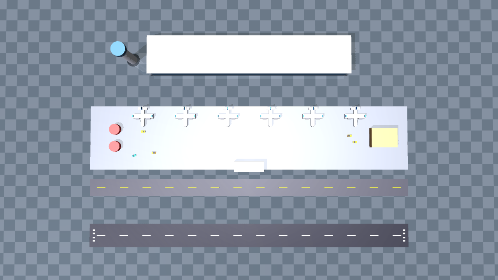
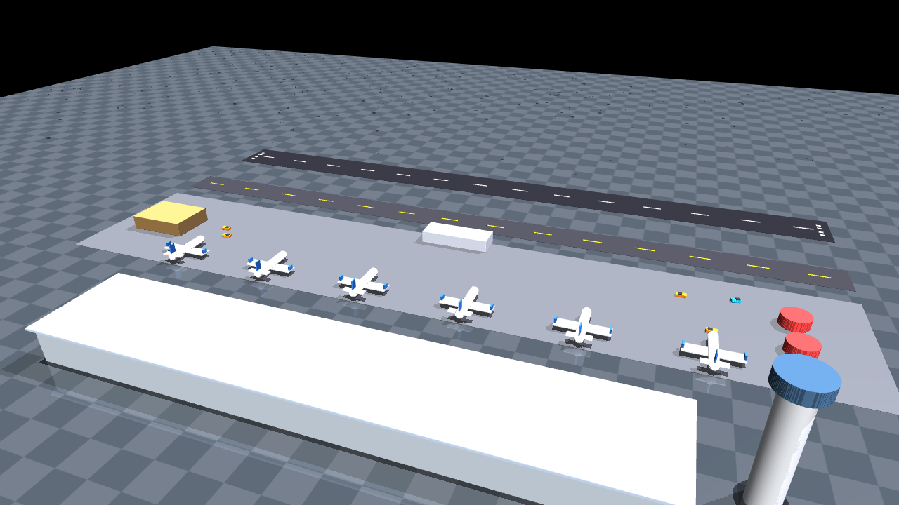

# Airport RL — a real-world 3D airport as a Reinforcement-Learning environment

A ready-to-run **Gymnasium + MuJoCo** environment that depicts an airport
ground-operations scene and lets you train an RL agent to drive a ground
vehicle across the apron. It is the airport analogue of the kind of 3D
multi-vehicle simulation you may have seen for a port: a full 3D scene, several
vehicles moving at once, and a standard RL interface you can plug a policy into.

The scene is a stylised, compressed model of a single-runway international
airport (proportions loosely following Noida International "Jewar" Airport):
one long runway, a parallel taxiway, an apron in front of a terminal, six gate
stands with parked aircraft, a control tower, and airside service facilities
(baggage hall, fuel farm, maintenance hangar).




---

## What the agent does

A **baggage tug / pushback tractor** starts at a service stand and must drive to
a target gate, avoiding parked aircraft, buildings and moving ground traffic
(the orange vehicles). The vehicle is driven by a *unicycle* velocity
controller, so the policy learns throttle + steering.

| | |
|---|---|
| **Observation** | `Box(30,)`: ego speed, heading (sin/cos), goal distance & bearing (sin/cos), plus 24 lidar range readings. Optional RGB image. |
| **Action** | `Box(2,)` = `[throttle, steering]`, each in `[-1, 1]` |
| **Reward** | progress toward the goal + small heading bonus − small step cost; **+50** on reaching the gate, **−50** (and termination) on collision |
| **Episode ends** | success (within the goal radius), collision, or 400 steps |

---

## Quick start

```bash
# 1. install (a single command — no C++ compiler needed)
pip install -r requirements.txt

# 2. see it running with random actions
python scripts/demo.py --render human --episodes 3

# 3. render preview stills to PNG
python scripts/preview.py --outdir previews

# 4. train a PPO policy (needs stable-baselines3, included in requirements)
python scripts/train.py --timesteps 300000 --n-envs 8 --out models/ppo_airport

# 5. watch the trained policy
python scripts/enjoy.py --model models/ppo_airport --render human
```

No display (server / CI)? Use headless mode:

```bash
MUJOCO_GL=egl python scripts/demo.py --render none --episodes 5
MUJOCO_GL=egl python scripts/demo.py --render rgb_array --episodes 1 --save-gif out.gif
```

Run the tests:

```bash
pip install pytest
pytest -q
```

---

## Project structure

```
airport-rl-env/
├── README.md
├── requirements.txt
├── setup.py
├── .gitignore
├── docs/
│   ├── airport_topdown.png      # preview images
│   ├── airport_hero.png
│   └── airport_chase.png
├── airport_rl/                  # the installable package
│   ├── __init__.py              # registers "AirportGround-v0"
│   ├── envs/
│   │   ├── __init__.py
│   │   ├── airport_env.py       # ← THE ENVIRONMENT (Gymnasium + MuJoCo)
│   │   └── config.py            # ← airport geometry + RL hyper-parameters
│   ├── scene/
│   │   ├── __init__.py
│   │   ├── airport_builder.py   # ← builds the whole airport as MJCF
│   │   ├── vehicle_factory.py   # ground vehicles (agent + traffic)
│   │   └── aircraft_factory.py  # parked aircraft
│   └── utils/
│       ├── __init__.py
│       └── math_utils.py
├── scripts/
│   ├── demo.py                  # random agent / gif
│   ├── preview.py               # render stills
│   ├── train.py                 # PPO training
│   └── enjoy.py                 # run a trained model
└── tests/
    └── test_env.py
```

**Where to edit what**

- Change the airport (runway length, gate count, building positions, colours) →
  `airport_rl/envs/config.py` (`AirportConfig`).
- Change the RL problem (speed limits, reward weights, lidar, episode length) →
  `airport_rl/envs/config.py` (`EnvConfig`).
- Change how the scene is assembled → `airport_rl/scene/airport_builder.py`.
- Change the vehicle/aircraft shapes → `vehicle_factory.py` / `aircraft_factory.py`.

---

## Using it from your own code

```python
import gymnasium as gym
import airport_rl                       # registers "AirportGround-v0"

env = gym.make("AirportGround-v0", render_mode="human")
obs, info = env.reset(seed=0)
for _ in range(1000):
    obs, reward, terminated, truncated, info = env.step(env.action_space.sample())
    env.render()
    if terminated or truncated:
        obs, info = env.reset()
env.close()
```

Why MuJoCo rather than PyBullet? PyBullet ships **no prebuilt wheels** and
compiles from source, which needs a C++ toolchain (a common blocker on Windows).
MuJoCo installs from a single `pip install` on Windows/macOS/Linux, renders well,
and is the current standard for RL environments. If you specifically want a
PyBullet port, the environment logic here (`airport_env.py`) is the part to
rewrite; the scene description is plain primitives either way.

---

## Dropping in real open-source 3D models

The scene is built entirely from primitives so it runs with zero downloads. If
you want photorealistic assets (e.g. CC0 models of an A320, a terminal, a tug
from Poly Haven / Sketchfab / Free3D), MuJoCo can load meshes directly:

1. Put the mesh under `airport_rl/assets/`, e.g. `airport_rl/assets/a320.obj`.
2. Reference it in the MJCF built by `airport_builder.py`:

   ```xml
   <asset>
     <mesh name="a320" file="airport_rl/assets/a320.obj" scale="0.01 0.01 0.01"/>
   </asset>
   <worldbody>
     <body name="aircraft_0" pos="0 -8 2.6">
       <geom name="aircraft_0_body" type="mesh" mesh="a320" rgba="0.9 0.92 0.95 1"/>
     </body>
   </worldbody>
   ```

3. Keep a simple box/capsule as the **collision** geom (add `contype`/`conaffinity`)
   and set the mesh geom to `contype="0" conaffinity="0"` if you only want it for
   looks. Lidar rays and collisions keep working off the collision geom.

`scale` is important — most downloaded models are in centimetres or inches.

---

## Troubleshooting

- **`ImportError: No module named 'airport_rl'`** — either `pip install -e .`
  from the project root, or run the scripts from the project root (the scripts
  add the root to `sys.path` themselves).
- **Blank/black renders on a headless machine** — set `MUJOCO_GL=egl`
  (or `osmesa`) before the command. On a normal desktop no variable is needed.
- **`pip install mujoco` fails** — you are likely on an unsupported Python
  (use 3.9–3.12) or an old pip; `pip install --upgrade pip` first.
- **Training is slow on CPU** — reduce `--n-envs`, or `pip install "torch"` with
  a CUDA build for GPU training.

---

## License / credits

Project code: MIT. The airport is a stylised original model generated from
primitives — it is not survey data of any real airport.
